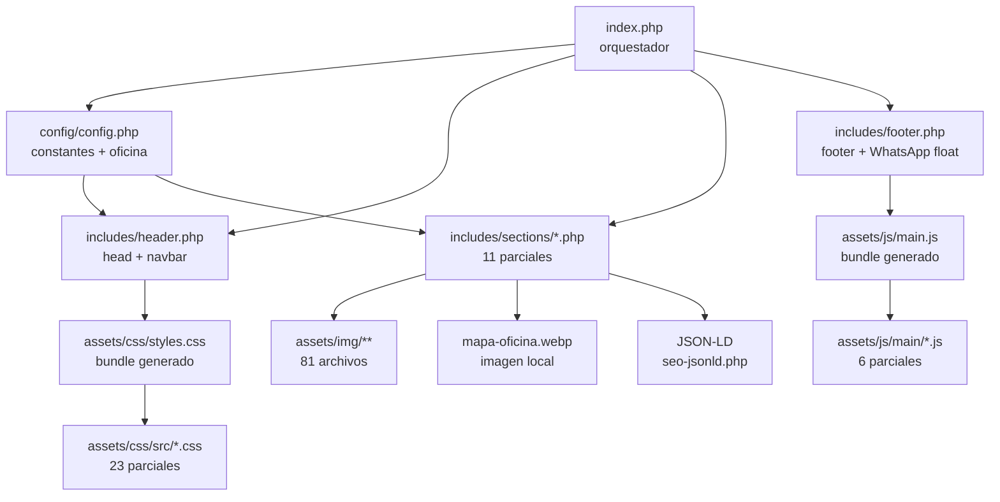
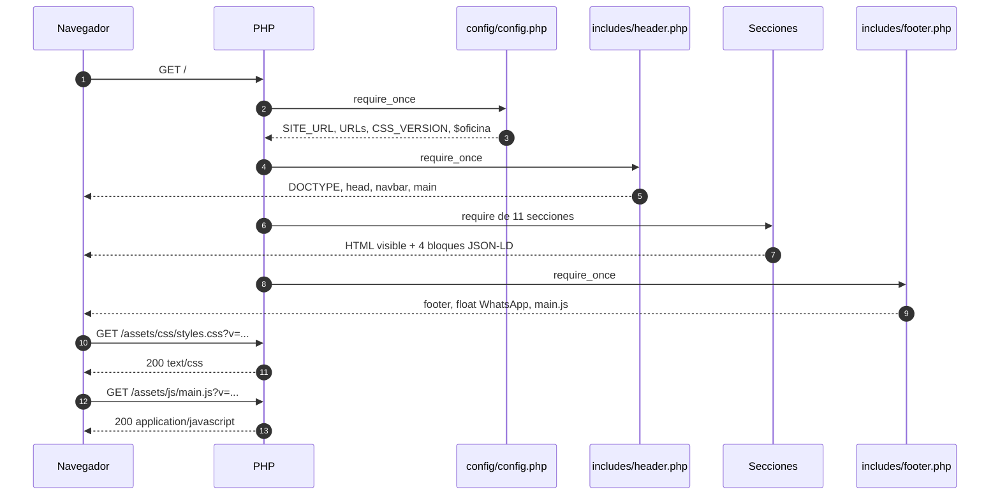
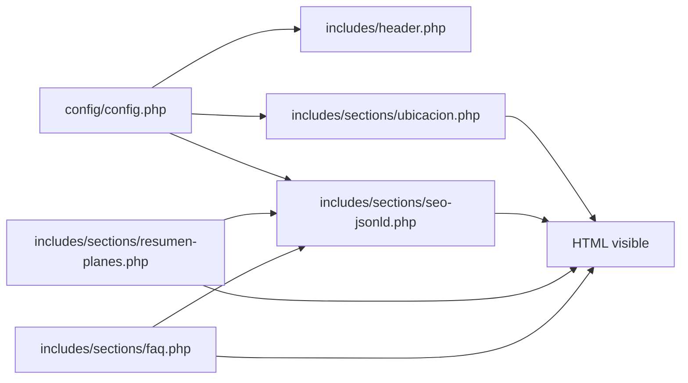

# Arquitectura — MiLocalWeb

La home se arma con un entrypoint orquestador (`index.php`), 11 parciales de sección, configuración central en `config/config.php` y dos builds reproducibles (CSS y JS). La fuente de verdad de constantes y datos de oficina es `config/config.php`; los textos comerciales, precios y FAQ todavía están duplicados entre secciones y JSON-LD.

## Mapa rápido

| Ruta | Responsabilidad |
|---|---|
| `index.php` | Orquestador de 32 líneas: carga `config/config.php`, `includes/header.php`, las 11 secciones y `includes/footer.php`, en ese orden |
| `config/config.php` | Constantes de sitio, detección local/producción, URLs de assets, OG, cache busting, zona horaria y `$oficina` (sin clave de Maps) |
| `includes/header.php` | `<!DOCTYPE>`, `<head>`, metadatos SEO/OG/Twitter, favicon, Google Fonts, `<link>` del CSS, navbar y apertura de `<main id="main-content">` |
| `includes/footer.php` | Cierra `</main>`, transición visual, footer, enlaces sociales, botón flotante de WhatsApp, `<script>` del bundle y cierre del documento |
| `includes/sections/hero.php` | Hero `#inicio`: H1, propuesta de valor, isotipo y CTA a planes/WhatsApp |
| `includes/sections/beneficios.php` | Beneficios `#beneficios`; alias legacy `#por-que` |
| `includes/sections/resumen-planes.php` | Resumen comercial `#resumen-planes` con 3 tarjetas, precios, financiación y compartir; alias `#planes` |
| `includes/sections/productos.php` | Detalle `#productos` de los planes `#plan-inicial`, `#plan-visible` e `#plan-imparable` |
| `includes/sections/confianza.php` | Vidriera `#confiaron-en-nosotros` con 3 webs reales y slot publicitario |
| `includes/sections/garantia.php` | Garantía `#garantia`; alias legacy `#conservas` |
| `includes/sections/complementarios.php` | Servicios adicionales `#complementarios`; alias `#servicios` y `#adicionales` |
| `includes/sections/faq.php` | FAQ `#preguntas-frecuentes` con 7 `
`; alias `#faqs` y `#preguntas` |
| `includes/sections/ubicacion.php` | Oficina `#ubicacion`: foto, dirección, link y mapa local `mapa-oficina.webp`; alias `#oficina` |
| `includes/sections/contacto.php` | Contacto `#contacto`: teléfono, WhatsApp y email |
| `includes/sections/seo-jsonld.php` | 4 bloques JSON-LD: `LocalBusiness`, `WebSite` + `WebPage`, `OfferCatalog`, `FAQPage` |
| `assets/css/src/` | 23 parciales CSS; el orden de cascada está en `tools/build-css.php` |
| `assets/css/styles.css` | Bundle generado y minificado (61.904 bytes). No editar a mano |
| `assets/js/main/` | 6 parciales JS; `00-header.js` abre el IIFE y `99-footer.js` lo cierra |
| `assets/js/main.js` | Bundle generado sin minificar. No editar a mano |
| `tools/build-css.php` | Concatena los 23 parciales en orden y aplica minificación conservadora |
| `tools/build-js.php` | Concatena los 6 parciales sin separadores ni minificación |
| `assets/img/` | 81 archivos, 5,92 MB; incluye material no referenciado |
| `docs/` | Documentación interna; no debe publicarse |
| `.htaccess` | Headers, GZIP, cache, bloqueo de `config` e `includes`, redirect `www` y HTTPS |
| `robots.txt` | Directivas de rastreo y declaración del sitemap |
| `sitemap.xml` | Sitemap estático con una sola URL |

## Diagrama de dependencias

## Flujo de un request

## Flujo de datos

## CSS y JS

### CSS

- Hay 23 parciales en `assets/css/src/`, numerados de `01-base.css` a `23-confianza.css`.
- `tools/build-css.php:24-48` define el orden exacto de concatenación. Ese orden reproduce la cascada del antiguo `styles.css` monolítico y **no debe reordenarse sin revisar el CSS**.
- El build elimina comentarios, colapsa espacios y escribe `assets/css/styles.css` (61.904 bytes). El bundle no conserva los banners `/* === archivo === */`.
- `includes/header.php:69` sigue cargando un único `styles.css` con `?v=filemtime`; no se cargan 23 `<link>` en producción.
- Regla: editar `assets/css/src/*.css` y ejecutar `php tools/build-css.php`. No editar `assets/css/styles.css`.

### JavaScript

- Hay 6 parciales en `assets/js/main/`: `00-header.js`, `01-smooth-scroll.js`, `02-faq.js`, `03-navbar.js`, `04-share.js`, `99-footer.js`.
- `00-header.js` abre el IIFE y activa `'use strict'`; `99-footer.js` lo cierra. Los parciales comparten el mismo scope.
- `tools/build-js.php:23-30` define el orden de ejecución. El build concatena sin separadores y sin minificar para facilitar el diagnóstico en producción.
- `includes/footer.php:94` carga `assets/js/main.js` sin `defer`; está al final del `<body>`, pero sigue siendo una deuda de especificación (JS-02).
- Regla: editar `assets/js/main/*.js` y ejecutar `php tools/build-js.php`. No editar `assets/js/main.js`.

## Invariantes

- `config/config.php` es la fuente de verdad de constantes, URLs y `$oficina`.
- Los precios, FAQ y textos comerciales **no** están centralizados: si cambian, hay que actualizar `resumen-planes.php`, `productos.php`, `faq.php` y `seo-jsonld.php` según corresponda.
- `assets/css/styles.css` y `assets/js/main.js` son artefactos generados; no se editan a mano.
- El orden de los `require` en `index.php` define el orden del DOM y debe coincidir con la navegación del header.
- El orden de `$sourceFiles` en `tools/build-css.php` define la cascada; el de `tools/build-js.php` define la ejecución del IIFE.
- Los parciales de sección se ejecutan en el scope global de `index.php`: heredan `$oficina` y las variables `$seo*`; no se deben reasignar.
- Las lecturas de assets dentro de `includes/sections/` usan `dirname(__DIR__, 2)` (6 ocurrencias: `hero.php:119`, `productos.php:278`, `ubicacion.php:13`, `contacto.php:18,22,26`). No volver a `__DIR__`.
- Guardar PHP en UTF-8 sin BOM y no emitir espacios antes de `<?php` en `index.php` o `header.php`.
- Mantener compatibilidad con PHP 7.4+; el entorno de prueba es PHP 8.4.6.

## Cómo trabajar con IA

1. Leer `docs/README.md`, `docs/estado-actual.md` y este archivo.
2. Leer `config/config.php` e `index.php` antes de tocar una sección.
3. No hay `AGENTS.md` local; aplicar las instrucciones globales del workspace (`C:\Users\Vivay\.config\opencode\AGENTS.md`).
4. Para CSS/JS, editar los parciales y ejecutar el build correspondiente; nunca editar el bundle.
5. Para mover código entre secciones, preservar el orden de includes, los anchors y el scope global; comparar el HTML renderizado antes/después.
6. Verificar con `php -l`, `GET /` y una revisión de los anchors/JSON-LD.
7. El mapa es local. Si se regenera, usar una key restringida por referrer/API y no commitearla.
8. No introducir frameworks, Composer ni Node.js: el stack es PHP plano.

## Riesgos estructurales

| Riesgo | Detalle | Mitigación |
|---|---|---|
| Cascada CSS frágil | `21-responsive.css` va antes de `22-utilidades.css` y `23-confianza.css`; mover parciales cambia el resultado | Respetar el orden de `tools/build-css.php:24-48`; comparar visualmente y con el CSS normalizado |
| Media queries dispersas | Los breakpoints viven en los parciales de cada componente, no solo en `21-responsive.css` | No partir bloques `@media` entre archivos; no moverlos sin revisar |
| Contenido duplicado | Precios en `resumen-planes.php`, `productos.php` y `seo-jsonld.php`; FAQ en `faq.php` y `seo-jsonld.php`; dirección en `config.php` y `seo-jsonld.php` | Centralizar en `config.php` en una tarea futura; mientras tanto, buscar todas las ocurrencias antes de cambiar un dato |
| Scope global compartido | Un parcial puede sobrescribir `$oficina`, `$seoTitle` o `$siteUrl` | Usar nombres únicos; no reasignar variables de configuración |
| Rutas de assets | `dirname(__DIR__, 2)` es obligatorio en secciones movidas; `__DIR__` apunta a `includes/sections/` | Mantener las 6 lecturas verificadas y probar el HTML |
| Nombres de assets | Archivos con espacios y mayúsculas; un renombre rompe referencias | Codificar URLs o renombrar con un mapa de referencias; no hacer renombres masivos sin prueba |
| Secretos | La key se eliminó del código/HTML, pero sigue en el historial de Git | Rotar la key y purgar el historial si el repo es público; ver P0 en `estado-actual.md` |
| Exposición de archivos | `.git/` y `docs/` expuestos; `.atl/` sin bloqueo | Bloquear en `.htaccess`, excluir del deploy y agregar `Disallow` |
| Dependencia externa | Google Fonts; el mapa ya es local | Auto-hospedar fuentes |
| Documentación desactualizada | `README.md` raíz describe rutas `/css` y `/js` que no existen | Usar `docs/` como fuente; actualizar el README raíz en una tarea aparte |
