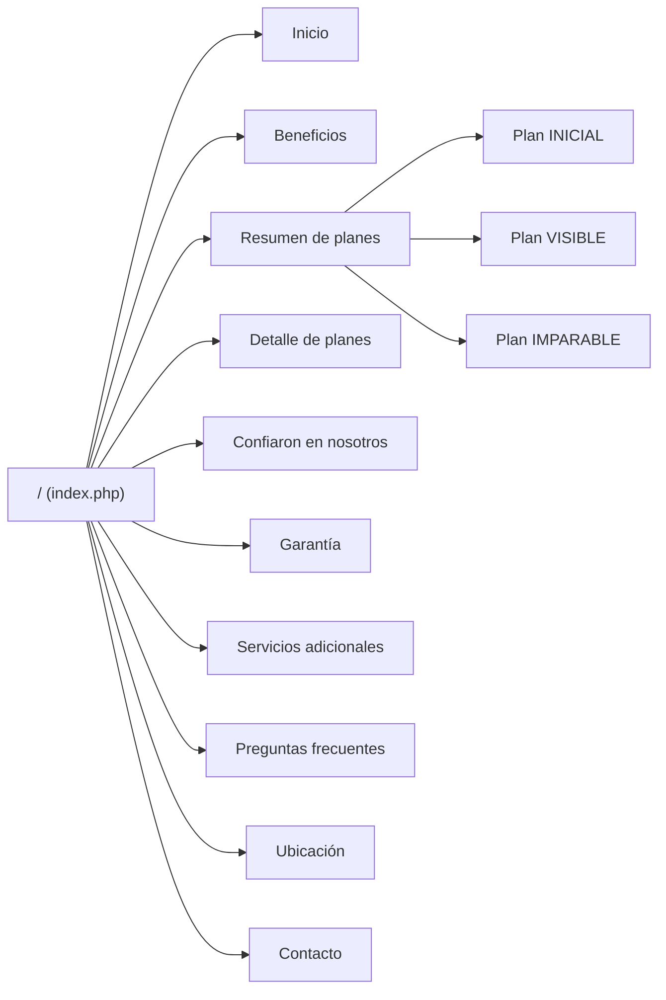

# Mapa del sitio — MiLocalWeb

Sitio single-page: una sola URL indexable (`/`) con navegación por anclas. No hay catálogo ni rutas públicas adicionales; `/pagos`, `/tutoriales` y `/descargas` están planificadas y no tienen archivo.

## URLs y rutas

| URL | Archivo/route | Propósito | Indexable | Canonical | Estado |
|---|---|---|---|---|---|
| `/` | `index.php` | Landing corporativa de servicios | Sí | `https://milocalweb.com.ar/` | 200 |
| `/assets/css/styles.css` | bundle generado | Hoja de estilos principal | No | N/A | 200 `text/css`; 61.904 B |
| `/assets/js/main.js` | bundle generado | Interacciones | No | N/A | 200 `application/javascript` |
| `/assets/img/logos/og-milocalweb-1200x630.jpg` | asset estático | Imagen Open Graph | No | N/A | 200 `image/jpeg`; 1200x630 |
| `/assets/img/iconos/favicon.ico` | asset estático | Favicon | No | N/A | 200 `image/vnd.microsoft.icon` |
| `/robots.txt` | archivo estático | Directivas de rastreo | No | N/A | 200 `text/plain` |
| `/sitemap.xml` | archivo estático | Sitemap | No | N/A | 200 `application/xml`; 1 URL |
| `/config/config.php` | `config/config.php` | Constantes internas | No | N/A | Bloqueado por `.htaccess:47` en Apache (no verificado en producción); en servidor embebido ejecuta sin salida |
| `/includes/*` | `includes/*.php` | Plantillas internas | No | N/A | Bloqueado por `.htaccess:47` en Apache (no verificado en producción); acceso directo da 500 en embebido |
| `/docs/*` | documentación | Documentación interna | No debería | N/A | 200 `text/markdown` en servidor embebido; expuesto |
| `/.git/*` | repositorio | Metadatos del repo | No debería | N/A | 200 en servidor embebido; expuesto |
| `/pagos` | sin archivo | Portal de pagos planificado | No | N/A | 404 esperado en Apache; JS intercepta; fallback 200 en embebido |
| `/tutoriales` | sin archivo | Tutoriales planificados | No | N/A | 404 esperado en Apache; JS intercepta; fallback 200 en embebido |
| `/descargas` | sin archivo | Descargas planificadas | No | N/A | 404 esperado en Apache; JS intercepta; fallback 200 en embebido |

> El servidor embebido de PHP 8.4 hace fallback de rutas inexistentes a `index.php`. Ese comportamiento no representa a Apache en producción; la auditoría lo verificó con un directorio temporal ajeno al proyecto.

## Diagrama de navegación

## Sitemap XML

- Existe: `sitemap.xml` (enlazado desde `robots.txt:9`).
- Contiene una sola URL: `https://milocalweb.com.ar/`.
- `lastmod` fijo: `2026-10-19` (`sitemap.xml:5`), anterior al último commit (`2026-11-09`).
- `changefreq: monthly`, `priority: 1.0`.
- No incluye `image:image` ni `geo:geo`.
- El sitemap no se genera dinámicamente; debe actualizarse en cada deploy relevante.

## Anclas internas

| Ancla | Sección | Enlace desde |
|---|---|---|
| `#inicio` | Hero | Navbar `includes/header.php:97`; definición `includes/sections/hero.php:10` |
| `#beneficios` | Beneficios | Navbar `includes/header.php:98`; definición `includes/sections/beneficios.php:13` |
| `#resumen-planes` | Resumen de planes | Navbar `includes/header.php:99`; definición `includes/sections/resumen-planes.php:14` |
| `#productos` | Detalle de planes | Tarjetas de planes `includes/sections/resumen-planes.php:39,73,106`; definición `includes/sections/productos.php:12` |
| `#plan-inicial` | Plan INICIAL | Tarjeta INICIAL `includes/sections/resumen-planes.php:39`; definición `includes/sections/productos.php:16` |
| `#plan-visible` | Plan VISIBLE | Tarjeta VISIBLE `includes/sections/resumen-planes.php:106`; definición `includes/sections/productos.php:91` |
| `#plan-imparable` | Plan IMPARABLE | Tarjeta IMPARABLE `includes/sections/resumen-planes.php:73`; definición `includes/sections/productos.php:176` |
| `#confiaron-en-nosotros` | Vidriera de clientes | Sin enlace en navbar; definición `includes/sections/confianza.php:16` |
| `#garantia` | Garantía | Navbar `includes/header.php:100`; definición `includes/sections/garantia.php:14` |
| `#complementarios` | Servicios adicionales | Navbar `includes/header.php:101`; definición `includes/sections/complementarios.php:15` |
| `#preguntas-frecuentes` | FAQ | Navbar `includes/header.php:102`; definición `includes/sections/faq.php:15` |
| `#ubicacion` | Oficina | Navbar `includes/header.php:103`; definición `includes/sections/ubicacion.php:38` |
| `#contacto` | Contacto | Navbar `includes/header.php:104`; definición `includes/sections/contacto.php:11` |
| `#main-content` | `<main>` | Skip-link `includes/header.php:72`; definición `includes/header.php:116` |

### Alias legacy

| Ancla | Destino | Evidencia |
|---|---|---|
| `#por-que` | `#beneficios` | `includes/sections/beneficios.php:11` |
| `#planes` | `#resumen-planes` | `includes/sections/resumen-planes.php:12` |
| `#conservas` | `#garantia` | `includes/sections/garantia.php:12` |
| `#servicios` | `#complementarios` | `includes/sections/complementarios.php:12` |
| `#adicionales` | `#complementarios` | `includes/sections/complementarios.php:13` |
| `#faqs` | `#preguntas-frecuentes` | `includes/sections/faq.php:12` |
| `#preguntas` | `#preguntas-frecuentes` | `includes/sections/faq.php:13` |
| `#oficina` | `#ubicacion` | `includes/sections/ubicacion.php:36` |

Los alias usan `aria-hidden="true"` y la clase `anchor-legacy`; no son secciones visibles, solo preservan enlaces antiguos.

## Enlaces internos y observaciones

- Los 8 anchors del navbar (`#inicio`, `#beneficios`, `#resumen-planes`, `#garantia`, `#complementarios`, `#preguntas-frecuentes`, `#ubicacion`, `#contacto`) existen en el HTML.
- `#productos` no está en el navbar; se llega desde las tarjetas de plan.
- `/pagos`, `/tutoriales` y `/descargas` (`includes/header.php:108-110`) no tienen archivo. El JS intercepta el click (`assets/js/main/03-navbar.js:120-128`), pero un crawler o un usuario sin JS recibe 404 en producción.
- El footer enlaza a `http://demo.milocalweb.com.ar` sin HTTPS (`includes/footer.php:74`).
- `docs/` y `README.md` son públicos por HTTP; `.git` queda expuesto en el servidor embebido. `.atl` tampoco está bloqueado por `.htaccess` y no debería publicarse.
- No existe `404.php`; las rutas inexistentes dependen del servidor.
- El canonical solo existe para `/`; las anclas no generan URLs canónicas propias.
- El `sitemap.xml` no refleja el último commit ni incluye imágenes; debe actualizarse antes de enviarlo a Search Console.

## Documentos relacionados

- [Estado actual](estado-actual.md)
- [Arquitectura](arquitectura.md)
- [Resumen de documentación](resumen-documentacion.md)
- [Checklist de deploy y validación SEO 2026](checklist-deploy-seo-2026.md)
